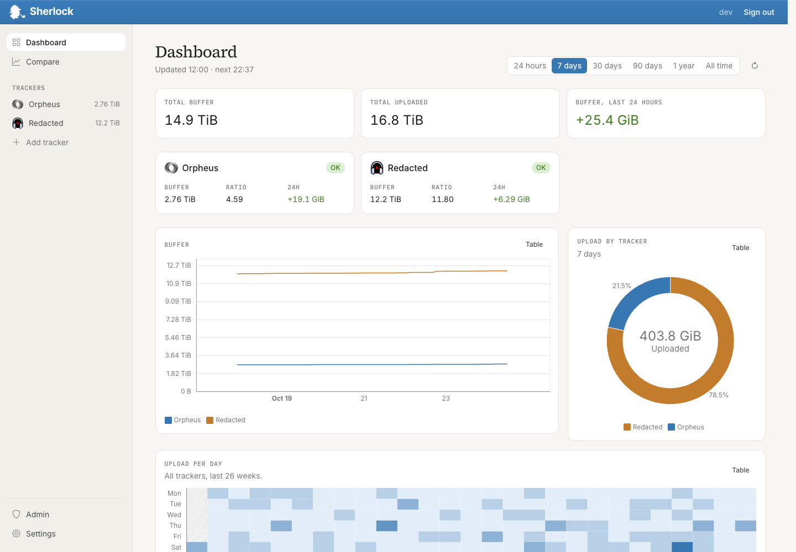
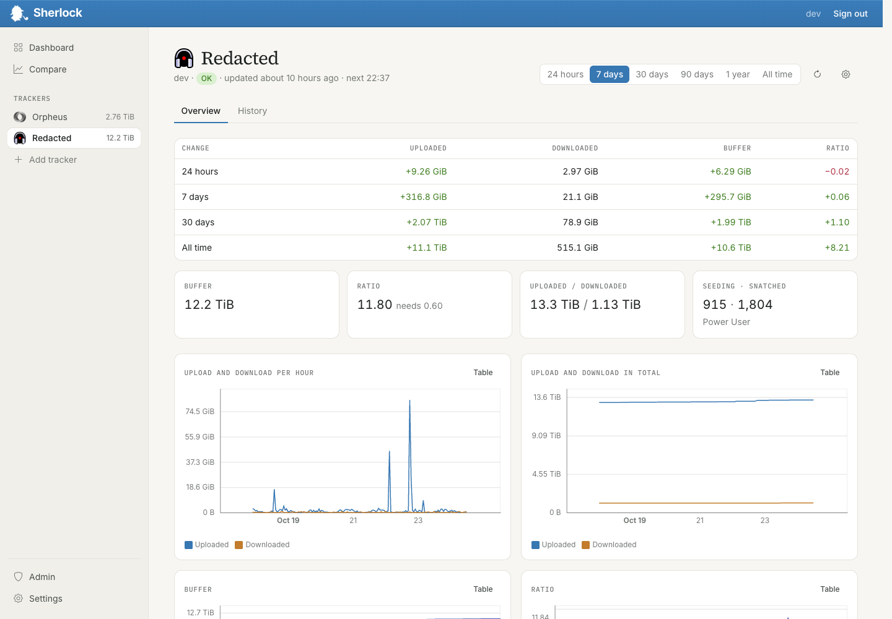
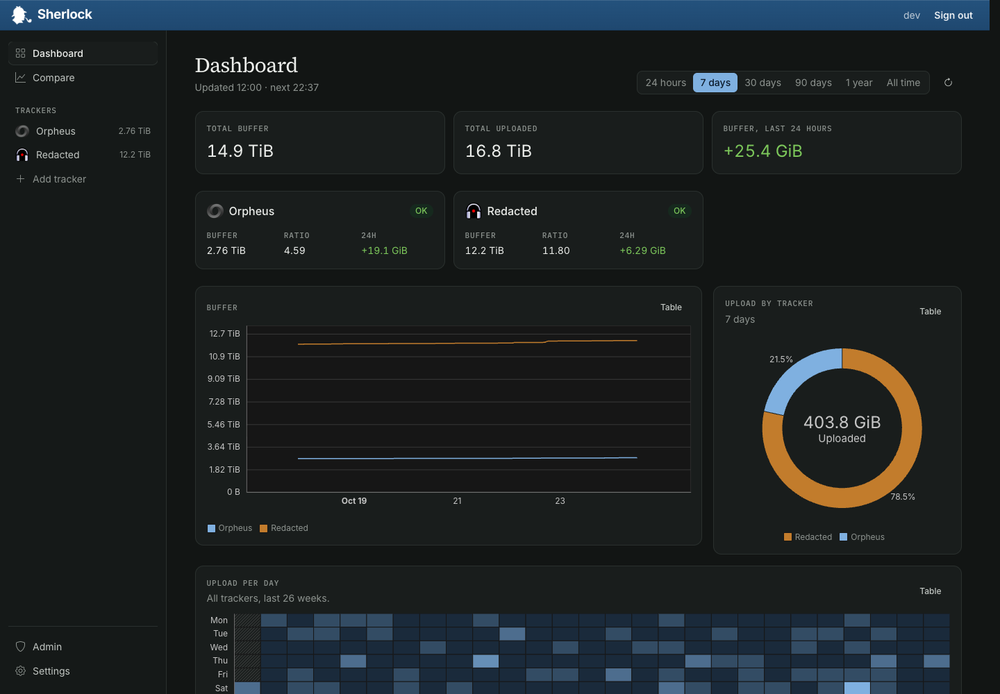

# Sherlock

Sherlock tracks your stats on private trackers over time: upload, download, ratio, bonus points and
more. Every hour it asks each tracker's API for your stats and draws the history. It uses your own API
key where the tracker allows that. Where it doesn't, the admin's key reads your profile on the tracker
once you opt in, so Sherlock sees only what your paranoia settings show other members.



| One tracker | Dark theme |
|---|---|
|  |  |

The screenshots use made-up demo data.

## Features

- A dashboard with all your trackers, and a history page for each one.
- Charts for upload, download, ratio and bonus points, plus a comparison across trackers.
- Supports Redacted, Orpheus, BroadcasTheNet, GazelleGames and HDBits. To ask for another, see
  [Requesting a tracker](#requesting-a-tracker).
- It can read your torrents from [qui](https://getqui.com) and show
  how many of them are cross-seeded: seeding the same files on more than one tracker.
- API keys are encrypted in the database and never shown again after you save them.
- Prometheus metrics: every user can scrape their own stats from `/users/metrics` with a token from
  Settings → Developer.
- Export and import your data, so it's easy to move between the hosted version and your own server,
  in either direction.
- Invite only. Users can invite others, and admins see the invite tree at `/admin`.
- Light and dark theme.

## Install on Debian (without Docker)

This is the complete guide to running Sherlock on your own Debian server, from an empty machine to a working
site. Docker is not needed. One script, `deploy/install-debian.sh`, does all the work on **Debian 9, 10, 11, 12
and 13**, and you run the same script again later to update.

**Contents:** [How it works](#how-it-works) · [Choose how to install](#choose-how-to-install) ·
[Requirements](#requirements) · [Install as root](#install-as-root-system-install) ·
[Install without root](#install-without-root-rootless) · [First login and setup](#first-login-and-setup) ·
[Options](#options) · [Everyday use](#everyday-use) · [Update](#update) · [Backup and restore](#backup-and-restore) ·
[Your own reverse proxy](#your-own-reverse-proxy) · [Moving from Docker](#moving-from-docker) ·
[Uninstall](#uninstall) · [Troubleshooting](#troubleshooting)

### How it works

```
 browser ──https──▶ nginx (port 80/443) ──▶ Sherlock (Rails + Puma, port 3000) ──▶ PostgreSQL
                                                  │
                                                  └─ hourly job inside the same process asks each tracker's
                                                     API for your stats (Solid Queue, SOLID_QUEUE_IN_PUMA=true)
```

- **Sherlock** is a Rails app. One process serves the website and also runs the hourly tracker polling.
- **PostgreSQL** keeps all data. API keys are encrypted with keys from the credentials folder.
- **nginx** (root install only) sits in front, handles HTTPS and passes requests on to Sherlock.
- **Ruby** is compiled once from source into its own folder, so the system Ruby is never touched and the
  version always matches `.ruby-version`. **Node.js** is downloaded only to build the JavaScript and CSS, then deleted.
- **Nothing else is installed system-wide**: no Docker, no Node, no extra Ruby.

### Choose how to install

The script looks at who runs it:

| | **Root install** (`sudo bash ...`) | **Rootless install** (`bash ...` as a normal user) |
|---|---|---|
| Use it when | You own the server and want a public site with HTTPS | You have no root or sudo, share a host, or want to try Sherlock |
| App | `/opt/sherlock` | `~/.local/share/sherlock/app` |
| Settings and credentials | `/etc/sherlock` | `~/.config/sherlock` |
| Runs as | system user `sherlock`, systemd service | you: `systemd --user`, or plain background processes if there is no user session |
| PostgreSQL | system service (version 18 when available) | private cluster in your home folder, port 54329, `127.0.0.1` only, or a database you already have |
| Web server | nginx on ports 80 and 443, optional free Let's Encrypt certificate | none: Sherlock listens on `127.0.0.1:3000` |
| System packages | installed with apt | cannot be installed: the script lists what is missing for an administrator |
| Control command | `sudo sherlock-ctl ...` | `~/.local/bin/sherlock-ctl ...` |

### Requirements

- **Debian 9, 10, 11, 12 or 13** (Ubuntu 22.04+ may work), on x86_64 or aarch64 (Debian 9: x86_64 only). Debian 9 to 11
  no longer get security updates; see [Older Debian releases](#older-debian-releases-9-10-11).
- At least **1.5 GB of RAM plus swap** (compiling Ruby is the hungry part) and about **3 GB of free disk**.
- Internet access during the install (apt, GitHub for ruby-build, nodejs.org, rubygems.org, npm).
- **Public site:** a domain name whose DNS `A` (and `AAAA`) record points at the server, and ports 80 and 443
  open in the firewall. **Private network:** nothing; use the IP address and `--no-ssl`.

### Install as root (system install)

**1. Get the code.**

```sh
sudo apt-get update && sudo apt-get install -y git
git clone https://github.com/race-in/Sherlock.git
cd Sherlock
```

**2. Run the installer.** Pick one:

```sh
# Public site: nginx plus a free Let's Encrypt HTTPS certificate
sudo bash deploy/install-debian.sh --domain sherlock.example.com --letsencrypt you@example.com

# Private network or home server: plain HTTP, reached by IP address or local name
sudo bash deploy/install-debian.sh --domain 192.168.1.10 --no-ssl
```

The script shows its settings and asks to continue (add `-y` to skip the question). It then runs these
steps and prints a heading for each. The first run takes **10 to 25 minutes**, nearly all of it compiling Ruby.

| Step | What happens |
|---|---|
| Checking the system | Debian version, CPU, memory, systemd |
| Installing system packages | build tools, libraries, `git`, `rsync`, `tzdata`, `sudo`, ... with apt |
| PostgreSQL | adds the official PostgreSQL repository, installs PostgreSQL 18 (or Debian's own version), creates the database `sherlockdb_prod` and its user with a random password |
| Folders and settings | creates the `sherlock` user and `/etc/sherlock/sherlock.env` |
| Ruby | builds the Ruby from `.ruby-version` with ruby-build (pinned to a verified commit) |
| Copying the app | copies the code to `/opt/sherlock` |
| Gems and assets | `bundle install`, downloads Node.js (checksum verified) to build JS and CSS, then removes it |
| Credentials | creates the encrypted credentials and the key in `/etc/sherlock/credentials` |
| Database | creates the tables (`db:prepare`) and loads the tracker list (`db:seed`) |
| systemd service | installs and enables `sherlock.service` and the `sherlock-ctl` command |
| nginx | installs nginx, writes the site, gets the certificate if you gave `--letsencrypt` |
| Starting Sherlock | starts the service and waits for `/up` to answer |

**3. Done.** The last lines print the address to open. If something fails the script stops with the
reason; fix it and run the same command again. Finished steps are skipped, so repeating is safe.

> **Back up `/etc/sherlock/credentials/production.key` right away.** It decrypts the saved API keys. Without
> it, a restored database is useless for those keys. Keep a copy off the server.

### Install without root (rootless)

For when you have no root or sudo. Everything stays in your home folder and runs as your user.

**1. Prepare the system once (needs an administrator).** An administrator runs one command that fixes the package
sources of old releases and installs every library the build needs:

```sh
sudo bash deploy/install-debian.sh --prepare-system
```

If you skip it, the script checks what is missing and prints exactly that, for example:

```text
Missing packages: libgmp-dev libpq-dev rsync

Ask an administrator to run this once ...:   sudo bash .../deploy/install-debian.sh --prepare-system
or, on a current release, just:               sudo apt-get install -y libgmp-dev libpq-dev rsync
```

No PostgreSQL package is needed: if the machine has no PostgreSQL 12 or newer, the script builds PostgreSQL 16
from source into your home folder (about 5 minutes) and runs its own private cluster. If you already have a
PostgreSQL server, use `--db-host` instead, see below.

**2. Get the code and run it.**

```sh
git clone https://github.com/race-in/Sherlock.git
cd Sherlock
bash deploy/install-debian.sh --domain localhost:3000
```

Use the name or address people will type in the browser as `--domain` (`localhost:3000`, `192.168.1.10:3000`,
`sherlock.example.com`). It must match, or Sherlock refuses the request. When you reach Sherlock directly on a port
(no proxy in front), include the port, so the links Sherlock makes work too. Behind your own proxy on 80/443, give
the host name only.

**3. Open it.** Sherlock listens on `127.0.0.1:3000` (this machine only). To reach it from other computers use
`--bind 0.0.0.0` and a firewall, or put your own HTTPS proxy in front, see
[Your own reverse proxy](#your-own-reverse-proxy), and add `--ssl`.

**4. Keep it running.** With a systemd user session it starts at login. To keep it running after you log out,
an administrator runs `sudo loginctl enable-linger YOUR_USER`. Without a user session it runs as background
processes: start it again after a reboot with `sherlock-ctl start`.

Rootless extras:

- Use an existing PostgreSQL instead of the private one:
  `bash deploy/install-debian.sh --domain localhost:3000 --db-host db.example.com --db-user sherlock --db-name sherlock --db-password PW`.
  The user must be able to create the `sherlockdb` schema in that database.
- Ports below 1024 are not allowed; the default is 3000.
- Add `~/.local/bin` to your `PATH` to type `sherlock-ctl` directly, or call `~/.local/bin/sherlock-ctl`.

### Older Debian releases (9, 10, 11)

The same script works on Debian 9 (stretch), 10 (buster) and 11 (bullseye), and takes care of what changed since
these releases ended:

| Problem on an old release | What the script does |
|---|---|
| Package files left `deb.debian.org` and `security.debian.org` | Points apt at `archive.debian.org` (Debian.org addresses only; other mirrors are left alone) and accepts its expired Release files. |
| Old OpenSSL (Debian 9) | The Ruby build compiles its own OpenSSL 3 (ruby-build does this on its own). |
| apt has only PostgreSQL 9.6 (Debian 9) or 11 (Debian 10); Sherlock needs 12+ | Builds PostgreSQL 16 from the official source tarball (checksum verified) and runs it as its own service (`sherlock-postgres`, port 54329, `127.0.0.1` only). Where apt has PostgreSQL 12 or newer (for example 13 on Debian 11) it uses that. |
| libpq 9.6 can't do SCRAM logins (Debian 9) | The private cluster uses md5 passwords there. |
| New Node.js needs a newer libc | Tries the current Node.js, then older ones, then the "glibc-217" builds that run even on Debian 9. The first that starts is used, only for the build. |
| Precompiled gems (`pg`, `nokogiri`, `prometheus-client-mmap`) need glibc 2.29 or newer (Debian 9 and 10) | Builds these three from source. For `prometheus-client-mmap` it installs Rust into the app user's home folder (`~/.cargo`, `~/.rustup`); on Debian 9 it also uses the libpq of the PostgreSQL it built and fetches a newer `libclang.so` from PyPI. The first install takes longer. |
| Old certbot (Debian 9) | `--letsencrypt` is refused on Debian 9; use `--no-ssl`, or your own HTTPS proxy with `--proxy none`. |

Debian 9 supports x86_64 only. These releases get no security updates any more: plan an upgrade.

### First login and setup

1. Open the address the installer printed. **Create the first account: it becomes the admin.** Do this
   yourself, right away, before anyone else finds the site.
2. In **Admin → Settings**, fill in the contact (an email address, your tracker username or an IRC channel).
   Every tracker request carries it so staff can reach you.
3. On your dashboard follow the setup: turn on your first tracker and paste your API key. Keys are encrypted
   and never shown again. Pick who may use each tracker in **Admin → Sites** (see
   [Who can use what](#who-can-use-what)).
4. Invite people from inside Sherlock if you want others to use it: users can invite each other, and admins see
   the invite tree in `/admin`. Sherlock is invite only.

The first stats appear within the hour, when the hourly job has run. To change a setting later, see
[Configuration](#configuration).

### Options

| Option | What it does |
|---|---|
| `--domain HOST` | Host name or IP Sherlock is reached at. Required on the first run, remembered after. |
| `--letsencrypt EMAIL` (root only) | With nginx: get a free HTTPS certificate for the domain. Needs DNS pointing here and port 80 open. |
| `--no-ssl` / `--ssl` | `--no-ssl`: plain HTTP, no redirect to HTTPS, no secure cookies (private network only). `--ssl`: force HTTPS. Root default is on, rootless default is off. |
| `--proxy nginx\|none` (root only) | `nginx` (default) installs nginx and keeps Sherlock on `127.0.0.1`. `none` makes Sherlock listen on `0.0.0.0:PORT` for your own proxy. |
| `--port N` | Port of the Sherlock web server. Default `3000`. |
| `--bind ADDR` | Address Sherlock listens on. Default `127.0.0.1` (`0.0.0.0` with `--proxy none`). |
| `--db-host HOST` | Use an existing PostgreSQL instead of installing one. Also `--db-port`, `--db-name`, `--db-user`. |
| `--prepare-system` (root only) | Fix the package sources of old releases, install every system package the build needs, then stop. Run it once before a rootless install. |
| `--print-packages` | Print the apt packages this system needs, then stop. |
| `--db-password PW` | Database password. Default: random, saved in the settings file. |
| `-y`, `--yes` | Ask no questions. |

All options: `bash deploy/install-debian.sh --help`. Options you give once are saved in the settings file, so
an update needs none.

### Everyday use

`sherlock-ctl` is the one command to remember. Root install: put `sudo` in front. Rootless: no sudo.

| Command | What it does |
|---|---|
| `sherlock-ctl status` | is it running? |
| `sherlock-ctl start` / `stop` / `restart` | control it (restart after editing the settings file) |
| `sherlock-ctl logs` | follow the log (Ctrl+C to stop) |
| `sherlock-ctl rails 'users:reset_password[alice]'` | give `alice` a temporary password, if you are locked out |
| `sherlock-ctl rails console` | Rails console, for experts |

Health check: `curl -fsS http://127.0.0.1:3000/up` answers `200` when it works.

Where to look:

| What | Root install | Rootless |
|---|---|---|
| Settings | `/etc/sherlock/sherlock.env` | `~/.config/sherlock/sherlock.env` |
| Credentials | `/etc/sherlock/credentials/` | `~/.config/sherlock/credentials/` |
| App log | `journalctl -u sherlock` | `sherlock-ctl logs` (`~/.local/share/sherlock/log/`) |
| Ruby build log | `/var/log/sherlock/ruby-build.log` | `~/.local/share/sherlock/log/ruby-build.log` |
| nginx site | `/etc/nginx/sites-available/sherlock` | none |

Change a setting: edit the settings file, then `sherlock-ctl restart`. The variables are in
[Configuration](#configuration). Settings you add by hand stay when you run the installer again.

### Update

```sh
cd Sherlock
git pull
sudo bash deploy/install-debian.sh          # rootless: bash deploy/install-debian.sh
```

No options are needed. The database, credentials and settings are kept, new gems and assets are built, the
database is migrated and the service restarts. Take a backup first (next section). If the new version
doesn't start, `git checkout` the previous commit, run the script again and restore the backup.

### Backup and restore

Two things matter: the **database** and the **credentials folder** (with `production.key`).

```sh
# Root install
sudo -u postgres pg_dump -Fc sherlockdb_prod > sherlock.dump
sudo tar -C /etc -czf sherlock-config.tar.gz sherlock

# Rootless install (private cluster); the password is in ~/.config/sherlock/sherlock.env
PGPASSWORD='the DB_PASSWORD value' pg_dump -Fc -h 127.0.0.1 -p 54329 -U sherlockdb_prod_write sherlockdb_prod > sherlock.dump
tar -C ~/.config -czf sherlock-config.tar.gz sherlock
```

Copy both files off the machine. To restore on a fresh server: run the installer, `sherlock-ctl stop`, restore
the config archive over `/etc/sherlock` (rootless: `~/.config/sherlock`), then load the dump:

```sh
# root install
sudo -u postgres pg_restore --clean --if-exists -d sherlockdb_prod sherlock.dump
# rootless install
PGPASSWORD='the DB_PASSWORD value' pg_restore --clean --if-exists -h 127.0.0.1 -p 54329 -U sherlockdb_prod_write -d sherlockdb_prod sherlock.dump

sherlock-ctl start
```

Sherlock can also export and import your own data from the web interface, which is the easy way to move a
single user between servers.

### Your own reverse proxy

Use this with `--proxy none` (root) or a rootless install behind HTTPS. Add `--ssl` so Sherlock knows the
outside connection is HTTPS, and make the proxy send the usual headers. Caddy does it all by itself:

```
sherlock.example.com {
    reverse_proxy 127.0.0.1:3000
}
```

nginx needs the headers spelled out (and the WebSocket upgrade for live updates):

```nginx
location / {
    proxy_pass http://127.0.0.1:3000;
    proxy_http_version 1.1;
    proxy_set_header Host $host;
    proxy_set_header X-Forwarded-For $proxy_add_x_forwarded_for;
    proxy_set_header X-Forwarded-Proto $scheme;
    proxy_set_header Upgrade $http_upgrade;
    proxy_set_header Connection "upgrade";
}
```

`--domain` must be the host name the proxy serves, without a path.

### Moving from Docker

If you already run Sherlock in Docker, the easiest way is the in-app export and import: export from the old
instance, install natively, create the first account and import. To move the database itself, restore your
dump into the new database and, **before the first run of the installer**, put the old `production.key` and
`production.yml.enc` in the credentials folder; otherwise the installer creates new keys and the saved API keys
can't be decrypted.

### Uninstall

Back up first if you might want the data again. **Root install:**

```sh
sudo systemctl disable --now sherlock
sudo rm -f /etc/systemd/system/sherlock.service /usr/local/bin/sherlock-ctl
sudo rm -f /etc/nginx/sites-enabled/sherlock /etc/nginx/sites-available/sherlock /etc/nginx/conf.d/sherlock-upgrade.conf
sudo systemctl reload nginx
sudo -u postgres dropdb sherlockdb_prod && sudo -u postgres dropuser sherlockdb_prod_write
sudo rm -rf /opt/sherlock /opt/rubies /opt/ruby-build /etc/sherlock /var/lib/sherlock /var/log/sherlock
sudo userdel sherlock
```

**Rootless install:**

```sh
sherlock-ctl stop
systemctl --user disable --now sherlock sherlock-postgres 2>/dev/null
rm -rf ~/.local/share/sherlock ~/.config/sherlock ~/.local/bin/sherlock-ctl ~/.config/systemd/user/sherlock*.service
```

### Troubleshooting

| Problem | What to do |
|---|---|
| The installer stopped with an error | Read the last red line, fix it, run the same command again. Finished steps are skipped. |
| `Missing packages: ...` (rootless) | Have an administrator run the `apt-get install` line it prints, then run the script again. |
| `bundle install failed` | A system library is missing; the error names it. Install it with apt and run again. |
| Ruby compile was killed or ran out of memory | Add swap: `sudo fallocate -l 2G /swapfile && sudo chmod 600 /swapfile && sudo mkswap /swapfile && sudo swapon /swapfile`, then run again. |
| Certificate refused | DNS must point at this server and ports 80 and 443 must be open. Fix that and run the same command again. |
| Browser shows "Blocked host" or a plain error page | `APP_HOST` in the settings file must equal the address in your browser. Fix it and `sherlock-ctl restart`. |
| Endless redirect or "too many redirects" | HTTPS is forced but the proxy doesn't send `X-Forwarded-Proto: https`. Fix the proxy, or use `--no-ssl` on a private network. |
| Login works but you are logged out at once | You use plain HTTP while HTTPS is forced. Use `--no-ssl` for plain HTTP, or HTTPS. |
| "Sherlock didn't come up" | `sherlock-ctl logs` shows why: usually the database password or port in the settings file, or the port is taken (`--port`). |
| Locked out of the admin account | `sherlock-ctl rails 'users:reset_password[username]'` |
| Port 3000 is already in use | Run the installer with `--port 3001`. With nginx and an existing certificate also change the port in `proxy_pass` in `/etc/nginx/sites-available/sherlock`, then `sudo systemctl reload nginx`. |
| Stats stay empty | The first poll runs within the hour. Check the tracker key under Settings, and `sherlock-ctl logs` for rate-limit or key errors. |
| Rootless: stopped after logout or reboot | An administrator runs `sudo loginctl enable-linger YOUR_USER`, or start it again with `sherlock-ctl start`. |

More on the installer's design: [DEBIAN.md](DEBIAN.md).

## Run it with Docker instead

The repository still has the original `Dockerfile`. Build the image yourself and run it against a PostgreSQL 18
you provide:

```sh
git clone https://github.com/race-in/Sherlock.git && cd Sherlock
docker build -t sherlock .
```

Create the credentials once (this writes `credentials/production.yml.enc` and `credentials/production.key`;
back the key up), then start the container against your PostgreSQL 18:

```sh
mkdir credentials
docker run --rm --user "$(id -u):$(id -g)" -e APP_HOST=setup \
  -v "$PWD/credentials:/rails/config/credentials" sherlock sh -c '
  { echo "secret_key_base: $(bin/rails secret)"; bin/rails db:encryption:init | tail -n 4; } > /tmp/credentials.yml
  EDITOR="cp /tmp/credentials.yml" bin/rails credentials:edit --environment production'

docker run -d --name sherlock --restart unless-stopped -p 3000:3000 \
  -e APP_HOST=sherlock.example.com -e FORCE_SSL=false \
  -e RAILS_MASTER_KEY="$(cat credentials/production.key)" \
  -e DB_HOST=your-postgres-host -e DB_PASSWORD=your-db-password -e SOLID_QUEUE_IN_PUMA=true \
  -v "$PWD/credentials:/rails/config/credentials:ro" sherlock
```

The container creates the database tables and refreshes the tracker list every time it starts. All variables
are listed in [Configuration](#configuration).

### Who can use what

Every tracker starts off. The admin turns on the first one in the setup on their dashboard, and picks
who can use each tracker in Admin → Sites:

- **Everyone.** Anyone on this Sherlock can add it.
- **Granted only.** Admins, and the people you turn the tracker on for on their page in Admin →
  Invite tree. A tracker you set up for only yourself starts out this way. HDBits only gives out the passkey from your
  torrents, and anyone holding it can download as you, so people should only add it to a Sherlock
  whose admin they trust.
- **Off.** Nobody can add it, it stops updating, and the keys members saved for it are deleted. Their
  history stays.

Taking a tracker away from someone stops it updating for them, but keeps their key and history.

**Running Sherlock for other people?** Check each tracker's rules first. Many don't allow members to
give their API key to someone else's service. Use your key for everyone where the tracker allows that,
or set the tracker to Granted only. You're responsible for what your instance asks members to share.

### Instance keys

The admin adds a tracker in Admin → Sites with their own key, as on any Sherlock, and ticks whether
people they invite can track their stats there too. On trackers whose API can read other members'
profiles (Redacted, Orpheus, PhoenixProject and GazelleGames) that uses the admin's key for everyone. Sherlock then reads each member's profile with that key, as other
members of the tracker see it. A member opts in by putting a Sherlock link on their profile; Sherlock
checks for it on every read and stops when it's gone. Paranoia applies, and bonus points aren't on
profiles. The key needs the User permission to read profiles, and Sherlock only sends it GET requests.
Switching deletes the members' own keys for that site; their history stays. The admin's own account
needs no link: their key reads it directly, with every stat.

Admins can also make open invites, for more than one person or without an end. They only let in
members of such a tracker: before joining, people put their opt-in link on their profile there, and
Sherlock checks it. So an open invite is safe to post in that tracker's forum.

Every tracker request carries the contact you set in Admin → Settings (an email address, your tracker
username or an IRC channel), so staff can reach you. Sherlock
sends each tracker at most one request per interval (2 seconds by default, set per site) from all
processes together, and pauses a site on its own when it answers 429 or keeps failing.

**Integrations** follow the same three choices, under Integrations on the same page. The only
one so far is qui, which starts out as Granted only.

**qui.** In Settings → qui, add the address of your [qui](https://getqui.com) and an API key from
qui's Settings → API Keys. Sherlock reads your torrents once an hour and shows, on the dashboard and
each tracker's page, how many seed the same files on another tracker, their size and their upload.
It only sends GET requests, but a qui key can do anything you can do in qui. Admins can add a qui on
a private network or over plain HTTP. Everyone else needs a public https address, so nobody else can
make the server reach into its own network.

### Configuration

| Variable | Required | What it does |
|---|---|---|
| `APP_HOST` | Yes | The domain Sherlock runs on. Requests for other hosts are refused. |
| `RAILS_MASTER_KEY` | Yes | Decrypts `credentials/production.yml.enc`. |
| `DB_PASSWORD` | Yes | Password of the Postgres user. |
| `DB_HOST`, `DB_PORT` | No | Where Postgres runs. Default `172.17.0.1:5432`. |
| `DB_NAME`, `DB_USER` | No | Database and user. Default `sherlockdb_prod` and `sherlockdb_prod_write`. |
| `FORCE_SSL` | No | `false` serves plain HTTP: no redirect to HTTPS, no secure cookies. Default `true`. |
| `SOLID_QUEUE_IN_PUMA` | No | Any value runs the worker inside the web container. Leave it unset only if you run `./bin/jobs start` in a container of its own. |
| `METRICS_PORT` | No | Port of the worker's own Prometheus metrics. Default `9394`. |
| `METRICS_BIND` | No | Address the worker's metrics listen on. Default `0.0.0.0`; the Debian installer sets `127.0.0.1`. |
| `JOB_CONCURRENCY` | No | Number of worker processes. Default `1`. |
| `RAILS_LOG_LEVEL` | No | Default `info`. |

### Prometheus

- `/users/metrics` serves one user's tracker stats. Create the bearer token in Settings → Developer.
- `/metrics` on port 3000 serves app metrics. It only answers requests from private or
  loopback addresses that didn't come through a proxy (no `X-Forwarded-For` header), so scrape it
  directly, not through your public domain.
- The worker serves poll metrics (`sherlock_polls_total`, `sherlock_poll_duration_seconds`) on
  `METRICS_PORT`, in the same process.

If you lock yourself out of the admin account, run
`sudo sherlock-ctl rails 'users:reset_password[username]'` (Docker: `docker compose exec sherlock bin/rails users:reset_password[username]`) to get a temporary password.

## Requesting a tracker

To get a tracker supported, open an
[issue on GitHub](https://github.com/race-in/Sherlock/issues) with:

- The tracker's name and URL, and the software it runs (Gazelle, Unit3D, its own).
- Where users create an API key or find their passkey, and whether that key can do more than read
  stats.
- The API endpoint that returns your stats, and its rate limit if it documents one.
- A real response from that endpoint, with your key, passkey, username, IP addresses and anything
  else personal removed.
- The hosts its announce URLs use, so cross-seeds from qui can be matched to it.

Sherlock only supports trackers with an API that takes a per-user key (an API key or passkey). It
never asks for passwords or cookies.

To work on Sherlock locally, run `bin/setup`. It starts Postgres in Docker (or uses one already listening on
port 5448), installs everything and starts the app.

## Credits

Sherlock started as a PHP app. We don't know who originally wrote it, but its source code was
maintained in [jimrollenhagen/sherlock](https://github.com/jimrollenhagen/sherlock). The icon and the
color theme come from that original.

This repository (https://github.com/race-in/Sherlock) is a fork that adds a native Debian installer to the upstream project at
[codeberg.org/whatstatus/sherlock-v2](https://codeberg.org/whatstatus/sherlock-v2).
