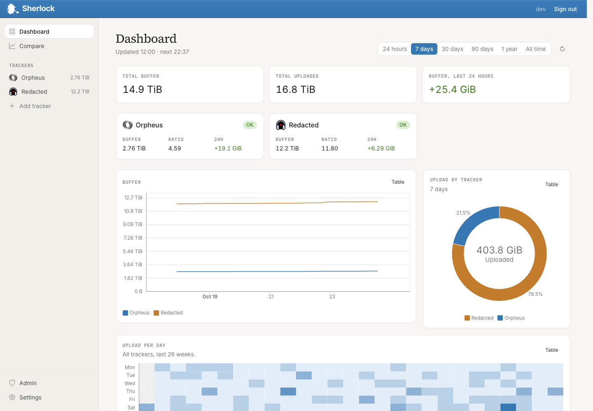
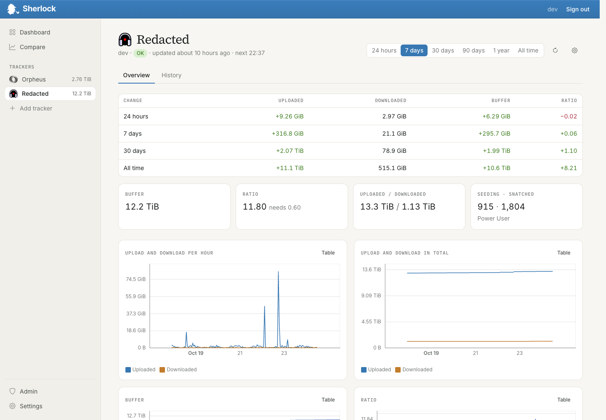
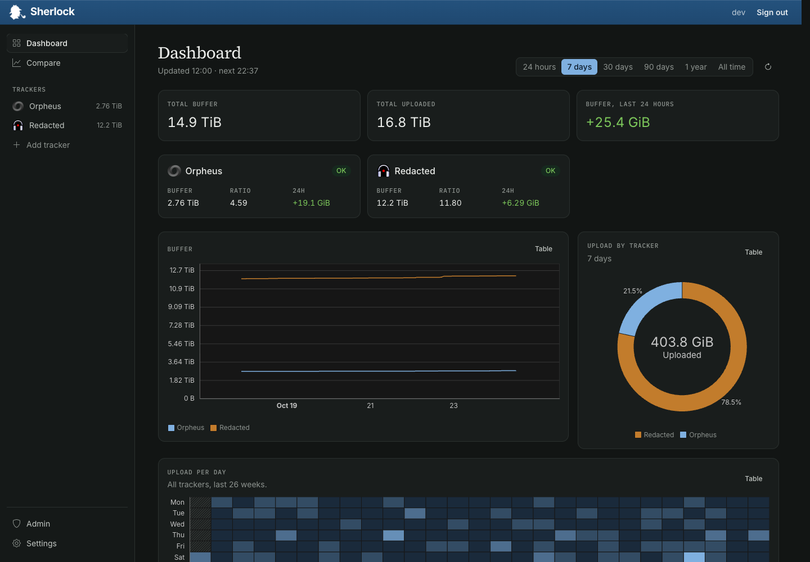

# Sherlock

Sherlock tracks your stats on private trackers over time: upload, download, ratio, bonus points and
more. Every hour it asks each tracker's API for your stats and draws the history. It uses your own API
key where the tracker allows that. Where it doesn't, the admin's key reads your profile on the tracker
once you opt in, so Sherlock sees only what your paranoia settings show other members.



| One tracker | Dark theme |
|---|---|
|  |  |

The screenshots use made-up demo data.

## Features

- A dashboard with all your trackers, and a history page for each one.
- Charts for upload, download, ratio and bonus points, plus a comparison across trackers.
- Supports Redacted, Orpheus, BroadcasTheNet, GazelleGames and HDBits. To ask for another, see
  [Requesting a tracker](#requesting-a-tracker).
- It can read your torrents from [qui](https://getqui.com) and show
  how many of them are cross-seeded: seeding the same files on more than one tracker.
- API keys are encrypted in the database and never shown again after you save them.
- Prometheus metrics: every user can scrape their own stats from `/users/metrics` with a token from
  Settings → Developer.
- Export and import your data, so it's easy to move between the hosted version and your own server,
  in either direction.
- Invite only. Users can invite others, and admins see the invite tree at `/admin`.
- Light and dark theme.

## Run it yourself

Two ways: [Docker](#run-it-yourself-with-docker), or [natively on Debian 11, 12 or 13](#install-natively-on-debian) without Docker.

## Run it yourself with Docker

Every release publishes an image to `codeberg.org/whatstatus/sherlock-v2`. You need Docker with
Compose. Sherlock expects a reverse proxy in front that serves it over HTTPS (Caddy, Traefik,
nginx). To run it over plain HTTP on a private network, set `FORCE_SSL=false`.

**1. Create your secrets.** This writes `credentials/production.yml.enc` and
`credentials/production.key`. Back up the key: without it, the saved API keys can't be decrypted.

```sh
mkdir credentials
docker run --rm --user "$(id -u):$(id -g)" -e APP_HOST=setup \
  -v "$PWD/credentials:/rails/config/credentials" codeberg.org/whatstatus/sherlock-v2 sh -c '
  { echo "secret_key_base: $(bin/rails secret)"; bin/rails db:encryption:init | tail -n 4; } > /tmp/credentials.yml
  EDITOR="cp /tmp/credentials.yml" bin/rails credentials:edit --environment production'
```

**2. Create a `.env` file** next to it:

```sh
APP_HOST=sherlock.example.com
DB_PASSWORD=a-long-random-password
RAILS_MASTER_KEY=paste-the-contents-of-credentials/production.key
```

**3. Create `compose.yml`.** Sherlock runs in one container, which serves the site and polls the
trackers. Leave out the `db` service if you already run Postgres 18, and set `DB_HOST` to it.

```yaml
services:
  db:
    image: postgres:18
    restart: unless-stopped
    environment:
      POSTGRES_DB: sherlockdb_prod
      POSTGRES_USER: sherlockdb_prod_write
      POSTGRES_PASSWORD: ${DB_PASSWORD}
    volumes:
      - db:/var/lib/postgresql
    healthcheck:
      test: pg_isready -U sherlockdb_prod_write -d sherlockdb_prod
      interval: 5s

  sherlock:
    image: codeberg.org/whatstatus/sherlock-v2:latest
    restart: unless-stopped
    depends_on:
      db: { condition: service_healthy }
    ports: ["3000:3000"]
    env_file: .env
    environment:
      DB_HOST: db
      SOLID_QUEUE_IN_PUMA: "true"
    volumes:
      - ./credentials:/rails/config/credentials:ro
    healthcheck:
      test: curl -fs http://localhost:3000/up
      interval: 5s
      start_period: 60s

volumes:
  db:
```

Without Compose, against a Postgres you already have:

```sh
docker run -d --name sherlock --restart unless-stopped -p 3000:3000 --env-file .env \
  -e DB_HOST=your-postgres-host -e SOLID_QUEUE_IN_PUMA=true \
  -v "$PWD/credentials:/rails/config/credentials:ro" codeberg.org/whatstatus/sherlock-v2:latest
```

**4. Start it** with `docker compose up -d`, point your proxy at port 3000 and open
`https://$APP_HOST/` (or `http://$APP_HOST:3000/` with `FORCE_SSL=false`). The first account you create becomes the admin. After that, people join with
invites.

The container updates the database and the tracker list every time it starts, and polls the
trackers every hour.

### Who can use what

Every tracker starts off. The admin turns on the first one in the setup on their dashboard, and picks
who can use each tracker in Admin → Sites:

- **Everyone.** Anyone on this Sherlock can add it.
- **Granted only.** Admins, and the people you turn the tracker on for on their page in Admin →
  Invite tree. A tracker you set up for only yourself starts out this way. HDBits only gives out the passkey from your
  torrents, and anyone holding it can download as you, so people should only add it to a Sherlock
  whose admin they trust.
- **Off.** Nobody can add it, it stops updating, and the keys members saved for it are deleted. Their
  history stays.

Taking a tracker away from someone stops it updating for them, but keeps their key and history.

**Running Sherlock for other people?** Check each tracker's rules first. Many don't allow members to
give their API key to someone else's service. Use your key for everyone where the tracker allows that,
or set the tracker to Granted only. You're responsible for what your instance asks members to share.

### Instance keys

The admin adds a tracker in Admin → Sites with their own key, as on any Sherlock, and ticks whether
people they invite can track their stats there too. On trackers whose API can read other members'
profiles (Redacted, Orpheus, PhoenixProject and GazelleGames) that uses the admin's key for everyone. Sherlock then reads each member's profile with that key, as other
members of the tracker see it. A member opts in by putting a Sherlock link on their profile; Sherlock
checks for it on every read and stops when it's gone. Paranoia applies, and bonus points aren't on
profiles. The key needs the User permission to read profiles, and Sherlock only sends it GET requests.
Switching deletes the members' own keys for that site; their history stays. The admin's own account
needs no link: their key reads it directly, with every stat.

Admins can also make open invites, for more than one person or without an end. They only let in
members of such a tracker: before joining, people put their opt-in link on their profile there, and
Sherlock checks it. So an open invite is safe to post in that tracker's forum.

Every tracker request carries the contact you set in Admin → Settings (an email address, your tracker
username or an IRC channel), so staff can reach you. Sherlock
sends each tracker at most one request per interval (2 seconds by default, set per site) from all
processes together, and pauses a site on its own when it answers 429 or keeps failing.

**Integrations** follow the same three choices, under Integrations on the same page. The only
one so far is qui, which starts out as Granted only.

**qui.** In Settings → qui, add the address of your [qui](https://getqui.com) and an API key from
qui's Settings → API Keys. Sherlock reads your torrents once an hour and shows, on the dashboard and
each tracker's page, how many seed the same files on another tracker, their size and their upload.
It only sends GET requests, but a qui key can do anything you can do in qui. Admins can add a qui on
a private network or over plain HTTP. Everyone else needs a public https address, so nobody else can
make the server reach into its own network.

### Configuration

| Variable | Required | What it does |
|---|---|---|
| `APP_HOST` | Yes | The domain Sherlock runs on. Requests for other hosts are refused. |
| `RAILS_MASTER_KEY` | Yes | Decrypts `credentials/production.yml.enc`. |
| `DB_PASSWORD` | Yes | Password of the Postgres user. |
| `DB_HOST`, `DB_PORT` | No | Where Postgres runs. Default `172.17.0.1:5432`. |
| `DB_NAME`, `DB_USER` | No | Database and user. Default `sherlockdb_prod` and `sherlockdb_prod_write`. |
| `FORCE_SSL` | No | `false` serves plain HTTP: no redirect to HTTPS, no secure cookies. Default `true`. |
| `SOLID_QUEUE_IN_PUMA` | No | Any value runs the worker inside the web container. Leave it unset only if you run `./bin/jobs start` in a container of its own. |
| `METRICS_PORT` | No | Port of the worker's own Prometheus metrics. Default `9394`. |
| `METRICS_BIND` | No | Address the worker's metrics listen on. Default `0.0.0.0`. |
| `JOB_CONCURRENCY` | No | Number of worker processes. Default `1`. |
| `RAILS_LOG_LEVEL` | No | Default `info`. |

### Prometheus

- `/users/metrics` serves one user's tracker stats. Create the bearer token in Settings → Developer.
- `/metrics` on port 3000 serves app metrics. It only answers requests from private or
  loopback addresses that didn't come through a proxy (no `X-Forwarded-For` header), so scrape it
  directly, not through your public domain.
- The worker serves poll metrics (`sherlock_polls_total`, `sherlock_poll_duration_seconds`) on
  `METRICS_PORT`, in the same container.

If you lock yourself out of the admin account, run
`docker compose exec sherlock bin/rails users:reset_password[username]` to get a temporary password.

## Install natively on Debian

`deploy/install.sh` installs Sherlock without Docker on Debian 11, 12 or 13 (x86_64 or arm64; Ubuntu 22.04+
usually works too). Debian doesn't ship a Ruby, Node or PostgreSQL new enough, so the script builds Ruby
under `/opt/rubies`, uses Node only for the build, and takes PostgreSQL 18 from the official PostgreSQL
repository. Nothing of Debian's own packages is replaced.

```sh
# as root, from the unpacked project folder
./deploy/install.sh --domain sherlock.example.com --letsencrypt you@example.com
```

That installs everything, creates the database, the encrypted credentials and a `sherlock` systemd service,
puts nginx in front of it and gets a certificate. The first run compiles Ruby, so give it 10 to 20 minutes.
Without `--letsencrypt` nginx serves plain HTTP on port 80, and with `--no-ssl` Sherlock stops insisting on
HTTPS (private networks only). `./deploy/install.sh --help` lists everything, including `--proxy none` if you
bring your own proxy, and `--db-host` to use a PostgreSQL you already have.

- **Update:** unpack the new version and run `./deploy/install.sh` again. It keeps your settings, database and
  credentials, and rebuilds the rest.
- **Settings:** `/etc/sherlock/sherlock.env` holds the [variables above](#configuration). Restart with
  `systemctl restart sherlock` after editing.
- **Back up** `/etc/sherlock/credentials/production.key`. Without it the saved API keys can't be decrypted.
- **Helper:** `sherlock-ctl status | restart | logs`, and `sherlock-ctl rails 'users:reset_password[username]'`
  if you lock yourself out.
- **Debian 11** has reached its end of life. If its repositories are gone from `deb.debian.org`, the script
  points apt at `archive.debian.org` (it keeps a `.sherlock-bak` copy of what it changes). Its PostgreSQL
  comes from the PostgreSQL archive repository; if that has no 17 or 18, it falls back to Debian's own
  PostgreSQL and loads the schema without the one setting PostgreSQL 16 and older reject.

## Requesting a tracker

Pull requests aren't open yet. To get a tracker supported, open an
[issue on Codeberg](https://codeberg.org/whatstatus/sherlock-v2/issues) with:

- The tracker's name and URL, and the software it runs (Gazelle, Unit3D, its own).
- Where users create an API key or find their passkey, and whether that key can do more than read
  stats.
- The API endpoint that returns your stats, and its rate limit if it documents one.
- A real response from that endpoint, with your key, passkey, username, IP addresses and anything
  else personal removed.
- The hosts its announce URLs use, so cross-seeds from qui can be matched to it.

Sherlock only supports trackers with an API that takes a per-user key (an API key or passkey). It
never asks for passwords or cookies.

To work on Sherlock locally, run `bin/setup`. It starts Postgres in Docker, installs everything and
starts the app.

## Credits

Sherlock started as a PHP app. We don't know who originally wrote it, but its source code was
maintained in [jimrollenhagen/sherlock](https://github.com/jimrollenhagen/sherlock). The icon and the
color theme come from that original.
